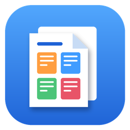
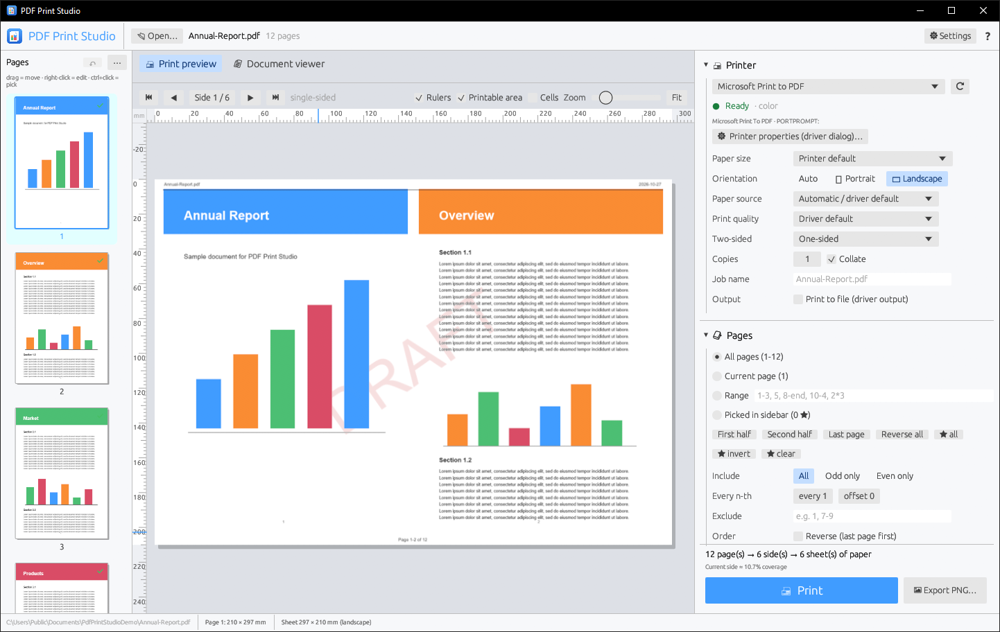
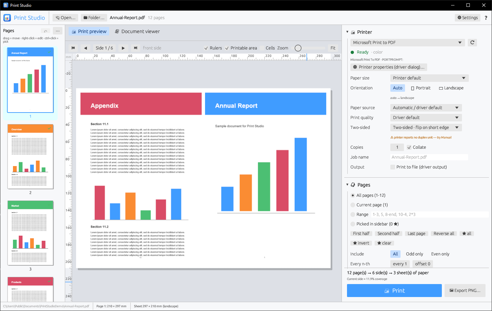
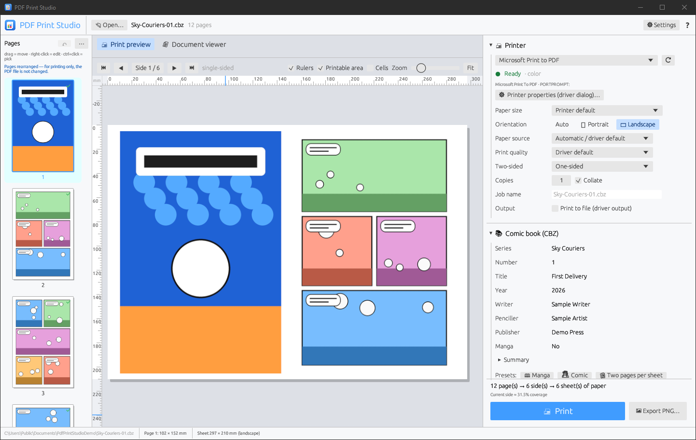
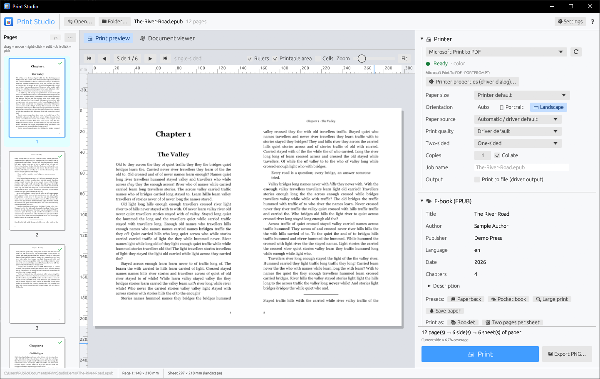
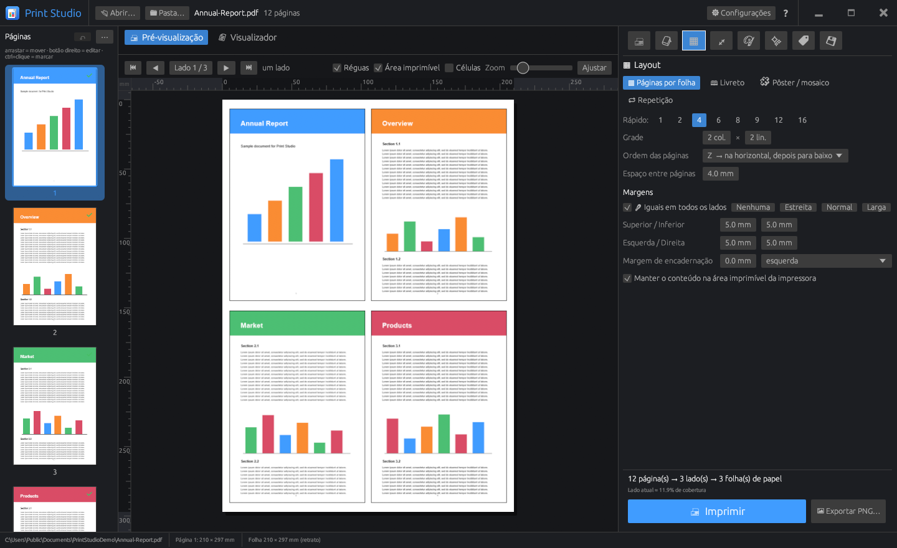

<p align="center">
  
</p>

<h1 align="center">PDF Print Studio</h1>

<p align="center">
  Print PDFs, comic books, e-books and photos exactly the way you want, on Windows.
</p>

<p align="center">
  <a href="https://github.com/mberehulka/pdf-print-studio/releases/latest/download/pdfprintstudio.exe"></a>
  <br>
  <a href="https://github.com/mberehulka/pdf-print-studio/releases/latest"></a>
</p>



PDF Print Studio gives you a live preview of the printed sheet before you print, and the preview always matches
what comes out of the printer. It's a single `.exe` and needs no installer, admin rights or extra DLLs.

## Features

**Layouts.** Put several pages on one sheet (any grid up to 16×16). Print a **booklet** that you fold and staple.
Spread a **poster** across several sheets, or repeat one page across the sheet for labels and business cards.



**Comic books (CBZ).** Open `.cbz` archives directly. You can read right-to-left for manga, split double-page
spreads into two pages, keep the cover on its own page, and skip credit pages or banners. The app also shows the
ComicInfo metadata and has presets for manga, comics, two-up and booklets.



**E-books (EPUB).** E-books have no fixed pages, so PDF Print Studio typesets them into real book pages. You choose
the page size (A5, A6, 6×9 in paperback…), margins, font, text size, line spacing, indents and justification.
Chapters can start on a new or right-hand page, and you can add a cover page, a generated table of contents,
running heads with the chapter title and page numbers. Presets cover paperback, pocket book, large print and
paper-saving; then print it as a booklet or two pages per sheet.



**Photos and pictures.** Open JPEG, PNG, GIF, BMP, TIFF, WebP, ICO, TGA, QOI and more, plus HEIC, AVIF and
camera RAW when the Windows extension for them is installed. Open one picture, several at once or a whole folder,
and each picture becomes a page. Print at the picture's own size or at standard photo sizes (10×15, 13×18,
20×25, passport, ID 3×4, wallet…), filling and cropping (you choose which part to keep) or showing the whole picture.
One click fits as many photos as possible on the paper, with cut marks. Photos are turned upright as the camera
recorded them, colour profiles (Adobe RGB, Display P3, CMYK) are converted, and auto levels brightens faded scans.
You also get every page of a multi-page TIFF, a background colour for transparent pictures, captions with the file
name and date, camera details, and a warning when a picture has too few pixels for the print size. Presets cover
full-page and borderless prints, 10×15 photos, ID photos and contact sheets.

**Arrange pages.** Drag thumbnails to reorder pages. Right-click a page to duplicate or delete it, insert a blank
page, or split it in half (a landscape page into two portrait pages, or the other way round). You can also split
every landscape page, or every portrait page, at once and leave the rest as they are. Undo with Ctrl+Z.
This only affects printing; your file is never modified.

**Watermarks, headers and stamps.** Add text or PNG watermarks, headers and footers, Bates numbers, "COPY" and
"APPROVED" boxes, and crop marks. They all use a small template language (`Page {page} of {pages}`,
`{if odd}…{end}`). A built-in manual (F1) has a live playground for trying templates.

**Color and quality.** Choose grayscale, black & white, dithering or halftone. Adjust brightness, contrast and gamma,
invert colors for dark-mode PDFs, or save toner. You can also set the render resolution, anti-aliasing and
sharpening.

**Printer control.** Pick the tray, paper, media and quality. Print two-sided, or use **manual duplex** on
printers without a duplex unit. You also get copies, collation, presets, PNG export and live printer status.

**Your way.** Light or dark theme, rulers in millimetres, English or **Português (Brasil)** (picked automatically
from your Windows settings), and a default window size and position.



## Install

1. [Download `pdfprintstudio.exe`](https://github.com/mberehulka/pdf-print-studio/releases/latest/download/pdfprintstudio.exe) and run it.
2. Open **⚙ Settings → Installation**. With one click each, you can:
   - install the program (Start menu entry, and an uninstall entry in Windows Settings → Apps),
   - add it to Explorer's **Open with** menu for PDF, CBZ, EPUB and picture files (page thumbnails in Explorer keep working),
   - add **Print with PDF Print Studio…** and **Quick print** to the right-click menu, and **Send to → PDF Print Studio**
     for printing several selected pictures together,
   - show **Explorer thumbnails** for PDF, CBZ and EPUB files: the first page, the comic's first page or the book cover
     instead of an icon.

Updates come from GitHub. To get the newest version, go to **⚙ Settings → About → Check for updates**.

Command line: `pdfprintstudio file.pdf`, `pdfprintstudio photo1.jpg photo2.jpg` or a folder, `--quick file.pdf` (prints with
the last settings), `--install`, `--uninstall`.

## Build from source

```powershell
cargo build --release     # target\release\pdfprintstudio.exe
cargo test
```

To publish a release, bump `version` in `Cargo.toml` and push a matching tag (`git tag v0.2.0 && git push origin v0.2.0`).
[GitHub Actions](.github/workflows/release.yml) then builds the binary and attaches it to the release.

---

Made by Muriel Guedes Pucci Berehulka.
